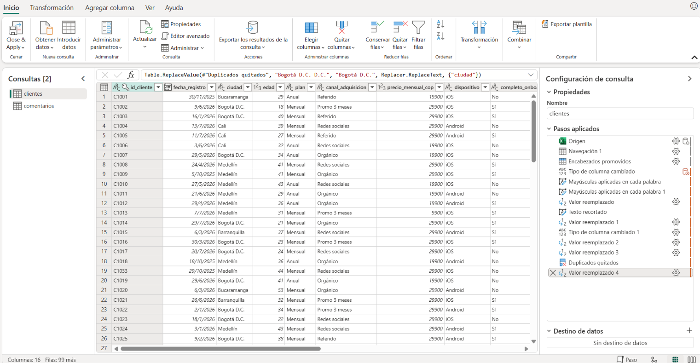
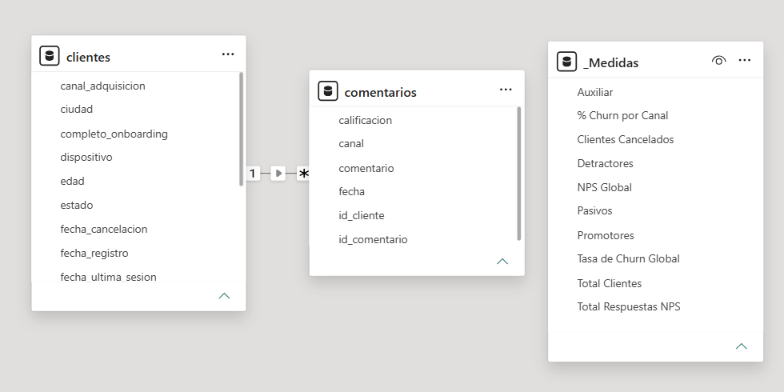
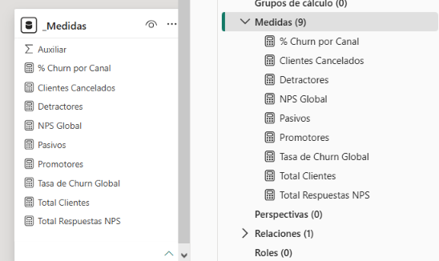
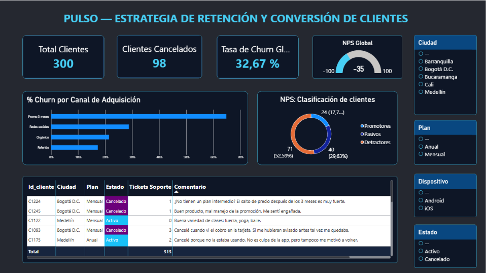
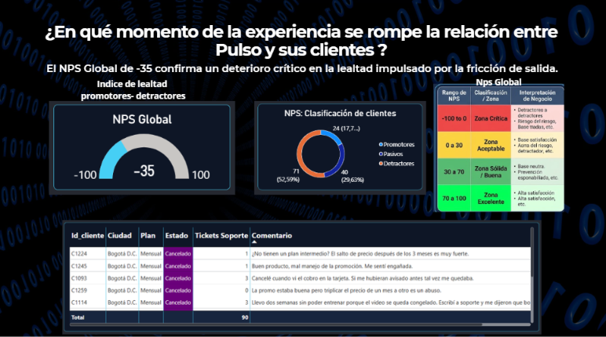

  <h1>📊 Retention Analysis & Anti-Churn Strategy – Pulso App</h1>
  

    <a href="#-english">🇺🇸 English</a> | 
    <a href="#-español">🇪🇸 Español</a>
  

---

## 🇺🇸 English

### 📋 Project Description & Business Questions
**Pulso** is a Colombian subscription-based home workout application that has been on the market for one year, offering three pricing tiers: Monthly Plan ($29,900 COP), Annual Plan ($19,900 COP/month equivalent), and a 3-Month Promo ($9,900 COP/month for the first 3 months, then transitioning to the standard monthly rate)[cite: 3.2].

Facing a steady rise in monthly cancellations and internal disagreement across teams (Marketing blamed pricing, Product blamed competition, and Support blamed loss of interest), this functional consulting and data analytics case study was conducted to answer the core business questions[cite: 3.2]:
1. **Why are customers leaving?** (Validating internal hypotheses with quantitative and qualitative data)[cite: 3.2].
2. **Which user segments, acquisition channels, and plans experience the highest churn?**
3. **What actionable retention strategies should leadership implement to reduce cancellations and improve Customer Experience (CX)?**[cite: 3.2]

### 🎯 Objective
Audit and clean raw customer and feedback datasets, build an analytical data model in Power BI, quantify key retention and satisfaction KPIs (Churn Rate and NPS), and deliver an executive strategy to mitigate customer churn[cite: 3.2].

### 🛠️ Technologies Used
* **Power BI Desktop:** Data modeling, interactive visualization, and executive reporting.
* **DAX (Data Analysis Expressions):** Custom KPI calculations, dynamic segmentation, and NPS classification.
* **Power Query & Microsoft Excel:** ETL processes, data auditing, deduplication, and normalization of structured and unstructured text data[cite: 3.2].

---

### 🔄 Step-by-Step Methodology

#### 1. Data Cleaning & Transformation (ETL)
The raw exports (`Pulso_clientes.xlsx` and `Pulso_comentarios.xlsx`) contained data quality issues requiring thorough auditing before analysis[cite: 3.2]. Using Power Query, duplicate records were removed, data types and city/plan naming conventions were standardized, null values were handled, and unstructured customer feedback (from app stores, support chats, cancellation surveys, and social media) was cleaned and linked to customer IDs[cite: 3.2].

#### 2. Entity-Relationship Modeling (Star Schema)
To ensure optimal performance and scalable filtering, a relational Star Schema was designed in Power BI. The central customer/subscription table was connected to dimensional attributes (subscription plans, acquisition channels, devices, and customer feedback) using clean one-to-many relationships.

#### 3. DAX Measures & KPI Engineering
Custom DAX measures were engineered to evaluate business health accurately, including **Total Customers (300)**, **Churned Customers (98)**, **Global Churn Rate (32.67%)**, **Global NPS (-35)**, and dynamic breakdowns of Promoters, Passives, and Detractors.

#### 4. Interactive Executive Dashboard
An executive dashboard was built to allow leadership to slice churn and satisfaction metrics by city, subscription plan, acquisition channel, device, and account status, integrating qualitative customer comments directly alongside quantitative KPIs.

#### 5. Research Findings & Strategic Anti-Churn Proposal
The investigation disproved single-factor assumptions and revealed the true drivers of churn, which were presented in a 10-minute executive deck[cite: 3.2]:
* **Key Findings:** A **32.67% Global Churn Rate** and a **-35 Global NPS** (52.59% Detractors). The **3-Month Promo** channel showed the highest churn spike (~65%) due to perceived "bill shock" when transitioning to the full $29,900 price without prior notice, compounded by unresolved support tickets.
* **Selected Strategies:**
  1. **Transparent Price Transition & Automated Alerts:** Implement proactive notifications before the 3-month promo ends, paired with an intermediate loyalty tier to prevent sudden price shock.
  2. **Proactive Onboarding & Engagement Triggers:** Automated check-ins and personalized workout recommendations during the first 30 days to build habit formation.
  3. **Support SLA Optimization:** Prioritize ticket resolution for users showing declining app usage or negative sentiment before they reach cancellation.

---

## 🇪🇸 Español

### 📋 Descripción del Proyecto y Preguntas de Negocio
**Pulso** es una aplicación colombiana de entrenamiento en casa por suscripción con un año en el mercado y tres modalidades de pago: Plan Mensual ($29.900 COP), Plan Anual (equivalente a $19.900 COP/mes) y Promo 3 meses ($9.900 COP/mes durante los primeros tres meses, pasando luego a tarifa mensual estándar)[cite: 3.2].

Ante el aumento sostenido de cancelaciones y la falta de consenso interno (Mercadeo culpaba al precio, Producto a la competencia y Soporte a la pérdida de interés), se desarrolló este caso de consultoría funcional y analítica de datos para responder las preguntas clave del negocio[cite: 3.2]:
1. **¿Por qué se están yendo los clientes?** (Sustentando el diagnóstico con evidencia cuantitativa y cualitativa)[cite: 3.2].
2. **¿Qué segmentos, canales de adquisición y planes concentran la mayor tasa de abandono?**
3. **¿Qué estrategias accionables debe implementar la gerencia para frenar el churn y mejorar la experiencia del cliente (CX)?**[cite: 3.2]

### 🎯 Objetivo
Auditar y depurar las bases de datos crudas de clientes y comentarios, construir un modelo analítico en Power BI, cuantificar indicadores clave de retención y satisfacción (Tasa de Churn y NPS) y diseñar una propuesta estratégica ejecutiva para mitigar la pérdida de suscriptores[cite: 3.2].

### 🛠️ Tecnologías Utilizadas
* **Power BI Desktop:** Modelado de datos, visualización interactiva y diseño de reportes ejecutivos.
* **DAX (Data Analysis Expressions):** Creación de métricas personalizadas, segmentación dinámica y cálculo de NPS.
* **Power Query y Microsoft Excel:** Procesos ETL, auditoría de calidad de datos, eliminación de duplicados y normalización de textos[cite: 3.2].

---

### 🔄 Proceso Paso a Paso

#### 1. Limpieza y Transformación de Datos (ETL)
Los archivos exportados (`Pulso_clientes.xlsx` y `Pulso_comentarios.xlsx`) presentaban inconsistencias que requerían auditoría previa[cite: 3.2]
